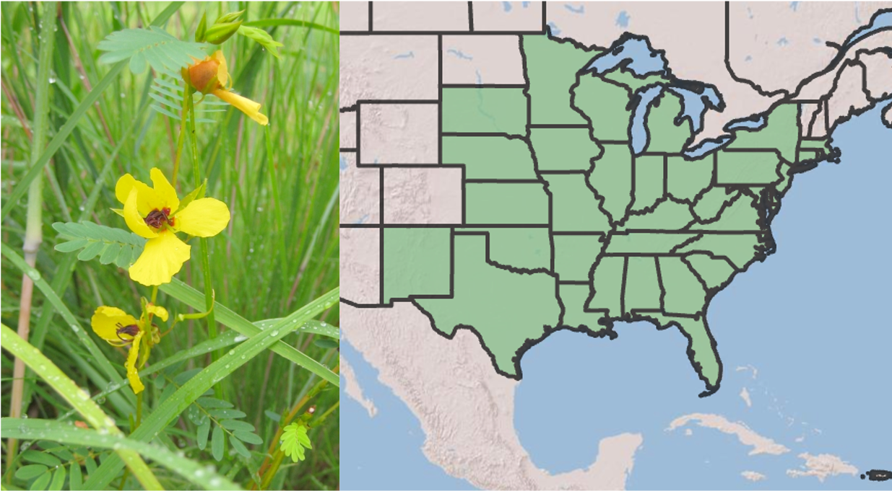

{#fig-chamae1 width=75%}

::: {.callout-tip}
## Before you start

* **Time:** about 3 hours (30 min preparation, 45 min hypothesis and predictions, 1–1.5 h analysis and writing).
* **Assumptions about background and guidance:** your `Rwork` project set up as in [Computer setup](02-computer-setup.qmd), and the ideas about interaction types (+,+; +,−; −,−) from [Direct interactions](10-direct-interactions.qmd). See [Appendix E](appendix_data-display.qmd) for additional assistance with graphing your data.
:::

## Goals

Do animals protect plants? If so, why and under what conditions would they do that? In this chapter, you'll investigate these questions as they apply to partridge pea (*Chamaecrista fasciculata*, @fig-chamae1).

In this chapter, you will

* evaluate whether or in what ways species help each other,
* develop testable hypotheses about species interactions,
* generate qualitative and quantitative predictions from your hypothesis,
* learn to recognize *context dependency* (an interaction) in a graph,
* refine your data display expertise, and
* start to develop a greater understanding and intuition for species interactions.

## Deliverables

Three documents:

1. **Your R script**, which has your name, date, and title, and loads packages, imports the data, sets the factor levels, and creates your graph.

1. **Your report**, which must include:
   a. Your hypothesis, and the one treatment you chose to compare with ants (water, AMF, or rhizobia).
   a. Your prediction, in writing.
   a. Your prediction, as a hand-drawn graph.
   a. Your Follow the Logic calculation: your predicted ant effect at each level of your chosen treatment, and whether your hypothesis predicts parallel lines.
   a. Your interaction graph of the data, with the same structure as your sketched prediction.
   a. A paragraph that includes
      i. an interpretation of your results,
      i. whether your results are consistent with your predictions, and in what ways,
      i. a short statement about what your results say about the hypothesis, and
      i. one limitation of using herbivore abundance as a measure of "protection."

1. **Audit the machine.** Below is an AI-generated interpretation of a graph like yours. Using your own graph and what you learned in this chapter, identify **at least three** claims that are wrong, unsupported, or overstated. For each one, quote the claim, explain the problem in one or two sentences, and say what evidence would be needed to support it.

   > *"Ants clearly protected partridge pea plants. The error bars for plants with and without ants do not overlap, which proves that ants significantly reduced herbivore abundance. Because herbivores reduce plant growth, this shows that plants with ants produced more seeds. The effect of ants was the same at both levels of the other treatment, so that treatment does not matter for this mutualism. Mycorrhizal fungi made plants healthier, which is why those plants had fewer herbivores."*

## Preparatory steps

* General background on mutualisms: download the slides and watch the video on [mutualisms (4c)](https://drive.google.com/drive/folders/1nWLoEGuWKIWdul9Uvse5qiB1Hf8MCwUv?usp=sharing){target="_blank"} before proceeding.
* For a quick summary of the species and experiment in this chapter, watch this [five-minute video](https://youtu.be/R8kAzAWI4no){target="_blank"}. (This was presented at the 2021 Annual Conference of the Botanical Society of America by a Miami University graduate student, Laura Fehling.)
* Data: download [`ArthropodObservations.csv`](https://raw.githubusercontent.com/HankStevens/introduction-to-ecology/main/data/ArthropodObservations.csv){target="_blank"} (right-click the link and choose "Save Link As…").
   1. Put `ArthropodObservations.csv` in the `data/` folder inside your `Rwork` project.
   1. Keep it in its simple "comma separated values" (.csv) format. Do not open and re-save it in a spreadsheet application.

<!-- HANK: the data link assumes data/ArthropodObservations.csv is committed to the public repo on main. Verify the link works after you push. -->

## Background on partridge pea and friends

Ecological mutualisms are mutually beneficial interactions between species. Ecologists often like to categorize pairwise species interactions using simple plus/minus signs; a mutualism is characterized thus: (+,+). Mutualisms between terrestrial plants and fungi are hundreds of millions of years old and underlie Earth's forests and grasslands. Symbiotic mutualisms between corals (which are animals) and dinoflagellates (a type of alga) allow for the coral reefs that structure Earth's shallow tropical seas. Mutualisms are all around us, and often go underappreciated. This chapter brings our attention to a small annual plant that has mutualisms with four completely different types of organisms, with multiple species within each of those types.

One good way to think about mutualisms is to identify the *types of rewards* that species share with each other. Often those rewards are **resources**, such as when a plant shares sugar with mycorrhizal fungi and the fungus shares phosphorus with the plant. Sometimes a reward is a **service**, as when a bumblebee pollinates a plant by carrying pollen to the stigma of another flower in return for nectar or some of that pollen. In many parts of the world, acacia trees provide ants with hollow thorns in which they can build nests, and ants defend the trees from herbivores of all kinds, from caterpillars to elephants [@bronstein2015m]. In this case, the ants provide the *service of defense*, in return for a resource (the physical structure of a hollow thorn).

For her thesis at Miami University, Laura Fehling investigated the multi-mutualist interactions of partridge pea [@fehling2022]. Partridge pea (*Chamaecrista fasciculata*, "cam-ee-crist'-a fa-sick'-u-la'-ta") has four mutualist partner groups: arbuscular mycorrhizal fungi, rhizobia bacteria (*Bradyrhizobium* sp.), ants, and pollinators (@fig-chamsys).

{#fig-chamsys width=75%}

*Chamaecrista fasciculata* is an annual legume^[Legumes are a group of plants including peas and beans that typically form rhizobia mutualisms.] that is native to the Midwestern and eastern United States, often occurring in open areas or disturbed sites in prairies and old fields (@fehling2022 and references therein). The *C. fasciculata* mutualist system is ideal for studying multiple mutualist effects given the diversity and manipulability of its partners. 

While all partners receive a form of plant carbon, each benefits the plant with a unique nutrition, protection, or transportation reward. These partners further represent diversity in their (i) physical association (symbiotic vs. non-symbiotic), (ii) degree of obligacy, and (iii) specificity to the focal species. Mycorrhizae increase the plant's uptake of nutrients (especially phosphorus) and water, and generally have beneficial effects on plant fitness because the extra nutrients support increased plant growth. Rhizobia form nodules in the roots of plants where they fix nitrogen into a form usable by plants, and the benefits they provide to the plant can vary. *C. fasciculata* depends primarily on bees for pollen transfer; its flowers reward bees with pollen rather than nectar, and it can self-pollinate at very low rates (references in @fehling2022).

In addition to producing showy flowers that attract bees and establishing mycorrhizae and rhizobial nodules, *Chamaecrista fasciculata* also produces nectar on its leaves in order to attract **ants**. At the base of the petiole of each compound leaf, there is a small extrafloral nectary (EFN), which produces nectar to attract ants for defense against herbivory. Unlike in many acacia–ant systems, the actual benefit of ants to the plant is not always clear. Sometimes they seem to help, and sometimes it is not clear whether they do.

Whether this behavior by ants actually helps a plant may depend on several things, including

* the costs to the plants of making the nectar and of getting eaten,
* the costs to the ants of removing herbivores and how effective they are at doing so, as well as the benefits of receiving plant nectar,
* particular environmental conditions that might influence costs, benefits, and herbivore density.

When the outcome of an interaction depends on other conditions like these, ecologists call it **context dependency**. You will look for it in your data.

As you saw in her video (see [Preparatory steps](#preparatory-steps)), Laura set up an experiment to test how mutualists interact and how the environment alters those interactions. In 2021, she established individual replicate *C. fasciculata* plants **with and without rhizobia, with and without mycorrhizal fungi, with and without ants, and under normal watering or drought**, for a total of 16 different experimental combinations (2 × 2 × 2 × 2). Along with lots of other data that Laura collected, she and her undergraduate field assistant observed and counted herbivorous insects on each plant every week all summer, for two minutes in the morning and two minutes in the afternoon. **You will analyze these data: the total abundance of herbivorous insects on each plant.**

## Your hypothesis and predictions

The data you have available are the **total count of herbivores on each plant**, summed across all of the summer's observation periods, and the combination of **experimental treatments** applied to each plant. Each plant is one row in the data set.

What you now know, based on the above text and preparatory information:

1. About half the plants had ants as normal, while the other half were prevented from having any ants through the use of sticky material applied around the rim and opening of pots (Tanglefoot, The Tanglefoot Company, Grand Rapids, MI).
1. The 16 combinations of experimental treatments (Can you write them all out? Start with "no AMF, no rhizobia, no ants, normal water.")
1. What the mycorrhizal fungi and rhizobia bacteria provide to plants.
1. What ants are thought to do.
1. Your data: the abundance of herbivores found on individual plants that received different treatments.

Questions you might consider:

* Aside from the potential effects of ants, which plants would be the healthiest?
* Which plants might be the most attractive to herbivores?
* Half the plants experienced drought - how might that influence the plants, the ants, and ant behavior?
* How would mycorrhizal fungi (AMF) and rhizobia affect plants, and how might those effects alter ant behavior?
* Not all herbivores are chewers - some feed on sap. Some ants protect and even farm sap-feeding insects such as aphids and treehoppers for their sugary honeydew. How would that change your expectations?
* Ant-exclusion experiments often keep ants off plants with a sticky barrier around the stem. What else might such a barrier keep off the plant?
* What is the relationship between *herbivore abundance* and  plant damage, growth, or seed production?

After you have considered the above questions, answer these two questions:

1. Which treatment(s) will create plants that attract the most **herbivores**?
2. Which treatment(s) will create plants that attract the most **ants**?

Use your answers for these two questions to generate a hypothesis about relationships between partridge pea, ants, and herbivores.  **Recall that a scientific hypothesis is an idea about how you think the world works.** A hypothesis differs from a prediction: a hypothesis is a mechanism that might operate generally with lots of different organisms, and it is not an observed result in a particular system. A prediction is a measureable outcome.


### Your predictions

Use your answers to these two questions to make a specific prediction that you can evaluate with the data we have (herbivore abundance and experimental treatments). To keep things manageable, you will compare plants with and without ants under **just one other treatment**. Choose one: water (normal vs. drought), mycorrhizal fungi (AMF vs. no AMF), or rhizobia (rhizobia vs. no rhizobia). Pick the one your hypothesis says the most about.

Then turn that prediction into a **hand-drawn graph** of what your data would look like if your hypothesized mechanism operated in this partridge pea system.

For example, imagine that I chose water, and answered the questions in this way:

1. Herbivores: I believe that drought-stricken plants will attract more herbivores because i think they may have softer leaves and lower concentrations of chemical defenses.
2. Ants: I believe that well-watered plants will attract more ants because those plants will be able to make more nectar.

Putting those together, I would predict that plants under drought have more herbivores overall, and that ants reduce herbivores much more on well-watered plants than on drought-stricken plants. My sketch would look like @fig-predict: the effect of ants depends on water.

{#fig-predict width=67%}

You will sketch your predictions on paper, take a photo of it, send your photo to your computer, and include the photo in your write-up for the deliverables.

Your hypothesis and graph should look different than mine. What matters is that your graph follows logically from your answers to the two questions.


::: {.callout-important}
## Follow the Logic: What does context dependency look like on a graph?

Return to the example in @fig-predict, where ants protect plants, but less so when plants are drought-stressed. Here are hypothetical mean herbivore counts:

| | No ants | Ants |
|---|---|---|
| Normal water | 2.0 | 1.0 |
| Drought | 3.0 | 2.5 |

**Step 1. Compute the ant effect in each water treatment.** The ant effect is (mean with ants) − (mean without ants).

* Normal: 1.0 − 2.0 = −1.0 herbivores per plant
* Drought: 2.5 − 3.0 = −0.5 herbivores per plant

**Step 2. Compare the two effects.** If ants had the same effect under both conditions, the two differences would be equal. Here, ants remove twice as many herbivores under normal watering. The effect of one factor (ants) *depends on* another factor (water). That is a statistical **interaction**, and it is what ecologists mean by context dependency.

**Step 3. Picture it.** Put ants on the x-axis and draw one line for each water treatment, connecting the two means. Equal effects give **parallel lines**. Context dependency gives lines that are **not parallel**, and in extreme cases lines that cross.

**Think further.** Now suppose the means were 2 → 1 under normal water and 4 → 2 under drought. The *differences* are −1 and −2 (not parallel), but the *ratios* are both 0.5 (ants remove half the herbivores in both cases). Is there context dependency? It depends on whether you think ants remove a fixed *number* or a fixed *fraction* of herbivores. Which seems more biologically reasonable, and why?

**Your turn.** Before you look at the data, write your predicted means for the four combinations of ants and your chosen treatment, compute the two ant effects by hand, and say whether your hypothesis predicts parallel lines.
:::

## Data analysis

### Set up your R session

First, open your `Rwork` project in RStudio by double-clicking `Rwork.Rproj` (or using File > Open Project…). Opening the project automatically sets your **working directory** to the `Rwork` folder, so you do not need `setwd()`.

You can confirm your *current* working directory with this:

```{r}
#| eval: false
getwd()
```

The result should end in `Rwork`. If it does not, you probably opened RStudio without opening the project.

Second, use RStudio to create a new file of the type "R script". Save it in the top level of `Rwork`, using a name that reflects this chapter, and end the file name with ".R" or ".r".

Third, add a comment as a brief description of the script, and load any R packages you know you will need.

```{r}
#| message: false
# Chapter 11 Mutualisms: Do ants protect pea plants? ----
# Your name, date

## Load packages ----
library(tidyverse)
# usually just the ggplot2 and dplyr packages within the tidyverse
```

### The data

Make sure that your data file is in the `data/` folder of your `Rwork` project and is still just a CSV file.

**Open the data file** (.csv file) in a text editor or in RStudio (click on it in the Files pane and choose "View File"). Do **not** save the file in a spreadsheet application, because it will try to change the format.

1. With the file open, learn what is on the first several lines. Often, the first line or two will have *metadata*, or information about the data (data about the data).
1. Below the metadata, you will see column headings, separated by commas, because the data are *CSV*, or comma-separated values.
1. Below the column headings are the data, with columns separated by commas.

Close the data file, and *do not save it.* If you save it, chances are good that the application will try to save it in a different format.

**Import the data**, or *read* the data into R. Here is code for that.

```{r}
## Import data ----
# skip the first 2 lines because they are metadata
d <- read.csv("data/ArthropodObservations.csv", skip = 2)
```

::: {.callout-note collapse="true"}
## Code walkthrough: `read.csv()`

* `read.csv()` expects a comma-separated file, with column headings on the first line it reads.
* `"data/ArthropodObservations.csv"` is the path to the file, *relative to your working directory* (`Rwork`). That is why the file must be in `Rwork/data/`.
* `skip = 2` tells R to ignore the first two lines (the metadata), so that the third line is read as the column headings.
* `d <-` stores the result as a data frame named `d`.
:::

Look at your data with one of these two:

```{r}
# glimpse(d)
# or
str(d)
```

* `AMF` indicates whether a plant did or did not have arbuscular mycorrhizal fungi.
* `Rhizobia` indicates whether a plant had or did not have symbiotic nitrogen-fixing bacteria.
* `Ants` indicates whether ants did or did not have access to the plant.
* `Drought` indicates whether a plant received normal watering or drought conditions.
* `Total` is the total number of herbivores observed on that plant, summed across all of the summer's observation periods.

Notice that the four treatment columns are *character* (`chr`) variables. R will sort them alphabetically in graphs, which puts "AMF" before "no_AMF" and "Rhiz" after "no_Rhiz", so controls end up in inconsistent places. Convert them to *factors* and put the control level first:

```{r}
## Set treatment levels, control first ----
d <- d |>
  mutate(AMF      = factor(AMF,      levels = c("no_AMF", "AMF")),
         Rhizobia = factor(Rhizobia, levels = c("no_Rhiz", "Rhiz")),
         Ants     = factor(Ants,     levels = c("no_Ants", "Ants")),
         Drought  = factor(Drought,  levels = c("Normal", "Drought")))
```

::: {.callout-note collapse="true"}
## Code walkthrough: `mutate()` and `factor()`

* `d |> mutate(...)` takes `d` and modifies or adds columns.
* `factor(AMF, levels = c("no_AMF", "AMF"))` turns the text column into a factor, a categorical variable whose levels have a fixed order. The order in `levels` is the order they will appear on graph axes and legends.
* `d <-` overwrites the old `d` with the new version.
:::

Now check how many plants are in each combination of ants and your chosen treatment. Here is the example with water; replace `Drought` with `AMF` or `Rhizobia` if you chose one of those.

```{r}
## Count plants per treatment combination ----
count(d, Ants, Drought)
```

Each group pools plants across the treatments you did not choose. For example, the "Ants, Normal" group includes plants with and without AMF and with and without rhizobia.

## Display the data to evaluate your predictions

Make an **interaction graph** of the data, with the same structure as your sketched prediction (@fig-predict): ants on the x-axis, one line for each level of your chosen treatment, and the mean number of herbivores per plant on the y-axis. Each mean has an error bar of ± one standard error. Behind them, faint jittered points show every plant in the data set, so you can see the raw data the means summarize.

Here is the code for the example with water. If you chose AMF or rhizobia, replace `Drought` with `AMF` or `Rhizobia` everywhere it appears.

```{r}
#| eval: false
## Interaction graph ----
ggplot(data = d, aes(x = Ants, y = Total, colour = Drought, group = Drought)) +
  geom_point(position = position_jitterdodge(jitter.width = 0.15,
                                             jitter.height = 0,
                                             dodge.width = 0.3),
             alpha = 0.3) +
  stat_summary(fun.data = mean_se,
               position = position_dodge(width = 0.3)) +
  stat_summary(fun = mean, geom = "line",
               position = position_dodge(width = 0.3)) +
  labs(x = NULL, y = "Herbivores per plant")
```

::: {.callout-note collapse="true"}
## Code walkthrough: the interaction graph

* `aes(x = Ants, y = Total, colour = Drought, group = Drought)` puts ants on the x-axis and gives each level of your chosen treatment its own colour. `group = Drought` tells `ggplot()` which means to connect with a line.
* `geom_point(...)` draws every plant as a faint point (`alpha = 0.3`). `jitter.width = 0.15` spreads the points sideways so they don't sit on top of each other. `jitter.height = 0` matters for counts: it keeps a plant with 2 herbivores plotted at exactly 2.
* `stat_summary(fun.data = mean_se)` calculates the mean and standard error of `Total` for each group and draws a point with an error bar.
* The second `stat_summary(fun = mean, geom = "line")` connects the two means for each level of your chosen treatment. These are the lines you compare with your prediction: parallel or not?
* `position_dodge(width = 0.3)` nudges the colours apart so their error bars don't overlap. All three layers use the same dodge width so that the points, error bars, and lines line up.
* `labs()` sets the axis labels.
:::

**Why means and not boxplots?** Our data are small whole-number counts, mostly 0, 1, and 2. Many groups have the same median, so medians and boxplots hide differences that the means can show. The jittered points let you see how variable the plants are around each mean, including the few plants with many herbivores that pull some means upward.

Once you have your graph, go back to the Follow the Logic box. Estimate the ant effect at each level of your chosen treatment from your graph, and compare those numbers to your predictions.

::: {.callout-tip collapse="true"}
## Going further (optional): a model for count data

Graphs let you *see* an interaction; a statistical model lets you *estimate* it. Because `Total` is a count, a generalized linear model with a log link is appropriate:

```{r}
#| eval: false
m <- glm(Total ~ Ants * Drought, family = quasipoisson, data = d)
broom::tidy(m)
```

* `Ants * Drought` fits the effect of ants, the effect of drought, and their interaction (`AntsAnts:DroughtDrought`). Replace `Drought` with your chosen treatment.
* With a log link, coefficients are on a *multiplicative* scale: `exp(estimate)` is the factor by which the mean count changes. This is the "fixed fraction" view from the Follow the Logic box.
* `quasipoisson` allows the variance to be larger than the mean. Check whether that is true: compare `mean()` and `var()` of `Total` within groups.
:::
